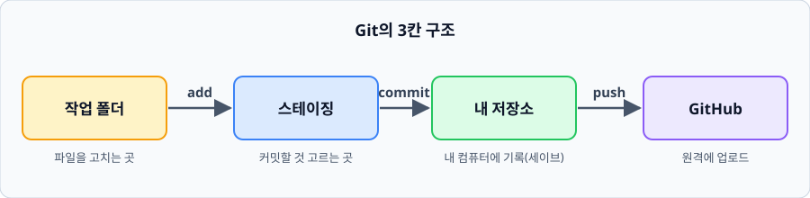
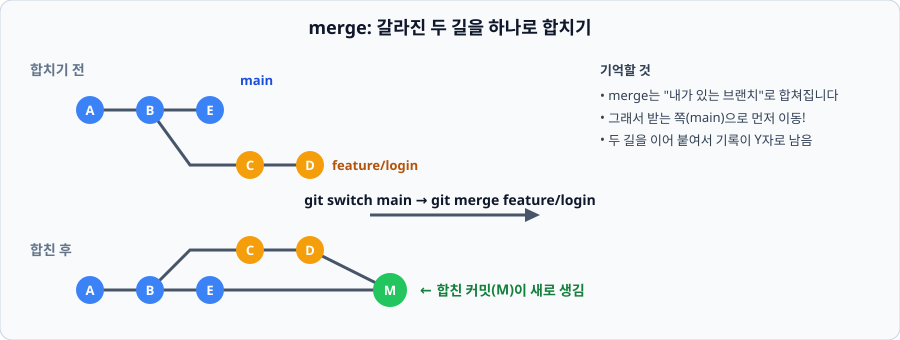
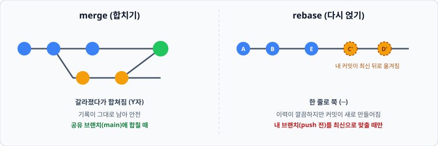
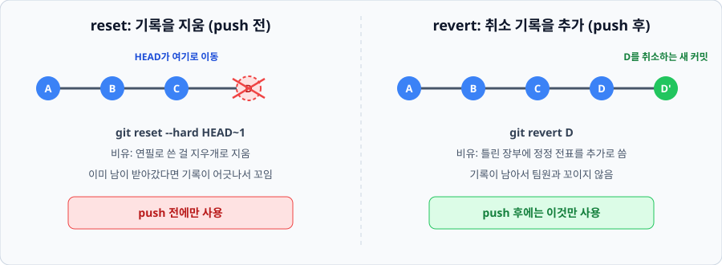
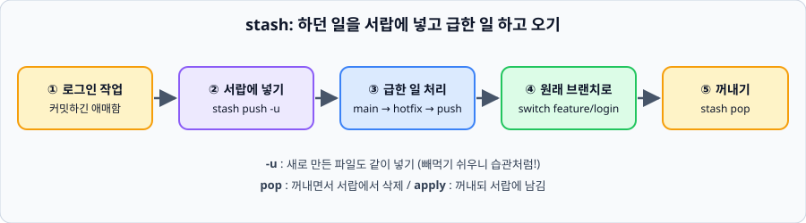

# Git 쉽게 쓰는 치트시트

> 이 문서는 **"지금 이런 상황인데 뭘 입력하지?"** 를 바로 찾을 수 있게 만든 표 모음입니다.
> 어려운 용어는 최대한 풀어서 썼습니다. 막히면 **8장(문제 생겼을 때)** 부터 보세요.

---

## 목차

1. [먼저 알아둘 단어 5개](#1-먼저-알아둘-단어-5개)
2. [상황별 바로 찾기 (메인 치트시트)](#2-상황별-바로-찾기-메인-치트시트)
3. [브랜치 (작업 공간 나누기)](#3-브랜치-작업-공간-나누기)
4. [병합 (작업 합치기)](#4-병합-작업-합치기)
5. [충돌 해결 (가장 중요)](#5-충돌-해결-가장-중요)
6. [되돌리기 (실수 복구)](#6-되돌리기-실수-복구)
7. [잠깐 저장하기 (stash)](#7-잠깐-저장하기-stash)
8. [문제 생겼을 때 응급 처치](#8-문제-생겼을-때-응급-처치)
9. [원격 저장소 (GitHub 등)](#9-원격-저장소-github-등)
10. [위험한 명령 (조심!)](#10-위험한-명령-조심)
11. [실전 시나리오 따라하기](#11-실전-시나리오-따라하기)
12. [마지막 3가지 원칙](#12-마지막-3가지-원칙)
13. [부록: 명령어 한눈에 보기](#부록-명령어-한눈에-보기)

---

<br/><br/><br/><br/><br/><br/><br/><br/>

## 1. 먼저 알아둘 단어 5개

| 단어 | 쉬운 설명 | 비유 |
|---|---|---|
| **저장소(repository)** | 내 코드가 들어 있는 폴더. 변경 기록을 전부 기억함 | 서류 캐비닛 |
| **커밋(commit)** | "지금 상태를 사진 찍어 저장" | 게임 세이브 |
| **브랜치(branch)** | 원본은 그대로 두고 따로 작업하는 **복사본 공간** | 문서 "사본 만들기" |
| **병합(merge)** | 따로 작업한 브랜치를 원본에 합치기 | 두 문서 합치기 |
| **충돌(conflict)** | 두 사람이 **같은 줄**을 다르게 고쳐서, 컴퓨터가 뭘 골라야 할지 모르는 상태 | 둘 다 "여기 고쳤어"라고 함 |

> 💡 **충돌은 에러가 아닙니다.** "내가 판단하기 어려우니 사람이 골라줘"라는 **정상적인 신호**입니다.

<br>

### Git의 3칸 구조 (이것만 알면 명령어가 보입니다)



대부분의 명령은 "이 칸에서 저 칸으로 옮기거나, 되돌리는 것"입니다.

---

<br/><br/><br/><br/><br/><br/><br/><br/>## 2. 상황별 바로 찾기 (메인 치트시트)

**지금 내 상황을 왼쪽에서 찾고, 오른쪽 명령을 그대로 입력하세요.**

| 지금 이런 상황이면 | 이걸 입력 |
|---|---|
| 지금 뭐가 바뀌었는지 보고 싶다 | `git status` |
| 바뀐 내용을 자세히 보고 싶다 | `git diff` |
| 커밋 기록을 보고 싶다 | `git log --oneline --graph -20` |
| 작업 시작 전 최신 코드로 맞추고 싶다 | `git fetch origin` → `git rebase origin/main` |
| 새 작업 공간(브랜치)을 만들고 싶다 | `git switch -c feature/기능이름` |
| 다른 브랜치로 이동하고 싶다 | `git switch 브랜치이름` |
| 내 작업을 커밋하고 싶다 | `git add -A` → `git commit -m "설명"` |
| 커밋을 GitHub에 올리고 싶다 | `git push` |
| 남의 브랜치를 내 작업에 합치고 싶다 | `git merge 브랜치이름` |
| **충돌이 났다** | 5장 참고 → 파일 고치기 → `git add` → `git commit` |
| 충돌이 너무 복잡해서 그냥 취소하고 싶다 | `git merge --abort` (또는 `git rebase --abort`) |
| 급한데 지금 작업을 잠깐 치워야 한다 | `git stash push -u -m "메모"` |
| 아까 치운 작업을 다시 꺼내고 싶다 | `git stash pop` |
| 방금 커밋 메시지를 고치고 싶다 (아직 push 전) | `git commit --amend` |
| 방금 커밋을 취소하고 싶다 (내용은 남기고) | `git reset --soft HEAD~1` |
| 이미 push한 커밋을 되돌리고 싶다 | `git revert 커밋ID` |
| 파일 하나를 예전 상태로 되돌리고 싶다 | `git restore 파일경로` |
| 뭔가 크게 잘못됐다. 예전 상태로 돌아가고 싶다 | `git reflog` → `git reset --hard HEAD@{번호}` |
| 브랜치를 지웠는데 필요해졌다 | `git reflog` → `git switch -c 브랜치이름 커밋ID` |

---

<br/><br/><br/><br/><br/><br/><br/><br/>## 3. 브랜치 (작업 공간 나누기)

### 자주 쓰는 명령

| 하고 싶은 것 | 명령어 | 설명 |
|---|---|---|
| 새 브랜치 만들고 바로 이동 | `git switch -c feature/login` | 가장 많이 씀 |
| 브랜치 이동 | `git switch develop` | 작업 공간 갈아타기 |
| 브랜치 목록 보기 | `git branch` | 현재 위치에 `*` 표시 |
| 원격까지 포함해 보기 | `git branch -a` | |
| 내 브랜치 상태 자세히 | `git branch -vv` | 원격과 몇 개 차이인지 표시 |
| 브랜치 이름 바꾸기 | `git branch -m 새이름` | 현재 브랜치 기준 |
| 다 쓴 브랜치 지우기 | `git branch -d feature/login` | 병합된 것만 삭제됨 |
| 억지로 지우기 | `git branch -D feature/login` | ⚠️ 작업 내용 사라질 수 있음 |
| GitHub의 브랜치 지우기 | `git push origin --delete feature/login` | |
| 사라진 원격 브랜치 정리 | `git fetch --prune` | 목록만 깔끔하게 |

<br>

### 브랜치 이름에 `/` (슬래시) 쓰는 이유

`/`는 그냥 **"폴더처럼 보기 좋게 구분하는 글자"** 입니다. Git이 특별히 다르게 처리하지 않아요.
실무에서는 **종류별로 앞글자를 붙이는 약속**으로 씁니다.

| 앞에 붙이는 말 | 언제 쓰나 | 예시 |
|---|---|---|
| `feature/` | 새 기능 개발 | `feature/login-page` |
| `bugfix/` | 버그 고치기 | `bugfix/null-check` |
| `hotfix/` | 급하게 고쳐야 하는 오류 | `hotfix/payment-error` |
| `release/` | 배포 준비 | `release/2.2.0` |
| `chore/` | 잡일(설정, 라이브러리 등) | `chore/update-deps` |

> ⚠️ 한 가지 주의: `feature` 브랜치와 `feature/login` 브랜치는 **동시에 만들 수 없습니다.**
> (폴더 이름과 그 안의 파일 이름을 동시에 쓸 수 없는 것과 같은 이치)

---

<br/><br/><br/><br/><br/><br/><br/><br/>

## 4. 병합 (작업 합치기)

### 4-1. 브랜치 머지하는 법

> **`git merge A`는 "A를 지금 내가 있는 브랜치로 가져온다"는 뜻입니다.**
> 그래서 **받는 쪽 브랜치로 먼저 이동**한 다음 merge 해야 합니다.
> (feature를 main에 합치고 싶다 → `main`으로 이동 → `main`에서 `merge feature`)



**기본 순서 (feature → main)**

```bash
git status                          # 1. 커밋 안 한 변경이 없는지 확인
git switch main                     # 2. 받는 쪽(main)으로 이동
git pull                            # 3. main을 최신으로 맞추기
git merge --no-ff feature/login     # 4. feature를 main에 합치기
git push                            # 5. 합친 결과 올리기
git branch -d feature/login                  # 6. 다 쓴 브랜치 삭제 (내 컴퓨터)
git push origin --delete feature/login       #    (GitHub)
```

| 단계 | 이유 |
|---|---|
| 1. `status` | 커밋 안 한 변경이 있으면 합치기가 꼬일 수 있음 |
| 2. `switch main` | merge는 "내가 있는 곳"으로 합쳐지기 때문 |
| 3. `pull` | 오래된 main에 합치면 나중에 push가 거부됨 |
| 4. `merge --no-ff` | "여기서 합쳤다"는 기록을 남김 |
| 6. `branch -d` | 병합된 브랜치만 안전하게 지워짐 |

**반대 방향 (main → feature): 내 브랜치를 최신으로 맞출 때**

```bash
git switch feature/login
git merge main                      # main의 새 내용을 내 브랜치로 가져오기
```

충돌은 보통 여기서 먼저 처리합니다. 그러면 main에 합칠 때 충돌 없이 깔끔하게 끝납니다.

**합친 결과 모양**

```
① 갈라졌던 경우: 합친 커밋(M)이 생김      ② main이 그대로인 경우 (fast-forward)
main:     A ── B ────── M                  main:     A ── B ── C ── D
                \      /                   (--no-ff 를 붙이면 이 경우에도 합친 커밋을 만듦)
feature:         C ── D
```

**충돌이 나면** → 5장 참고. 판단이 안 서면 `git merge --abort` 로 합치기 시작 전으로 돌아갑니다.

**자주 하는 실수**

| 실수 | 증상 | 해결 |
|---|---|---|
| 방향을 반대로 함 | 의도와 다른 브랜치가 바뀜 | push 전: `git reset --hard HEAD~1` / push 후: `git revert -m 1 머지커밋ID` |
| 커밋 안 하고 merge | "Your local changes would be overwritten" | 먼저 커밋하거나 `git stash` |
| main을 안 받고 merge | push 때 rejected | `git pull --rebase` 후 다시 `git push` |
| merge 후 `branch -d` 실패 | "not fully merged" | 합쳐지지 않은 커밋이 있다는 뜻. 확인 후 결정 |

**실무에서는 PR(Pull Request)로 합칩니다**

```bash
git push -u origin feature/login    # 1. 브랜치 올리기
# 2. GitHub에서 Pull Request 생성 → 리뷰 → "Merge" 버튼 클릭
git switch main
git pull                            # 3. 합쳐진 결과를 내 컴퓨터로 받기
git branch -d feature/login         # 4. 정리
```

GitHub의 Merge 버튼은 서버에서 위의 `git merge` 와 같은 일을 해 줍니다.

<br>

### 4-2. 합치기 관련 명령 모음

| 하고 싶은 것 | 명령어 | 설명 |
|---|---|---|
| 내 브랜치에 다른 브랜치 합치기 | `git merge feature/login` | 내가 있는 곳으로 합쳐짐 |
| 합친 흔적을 남기기 | `git merge --no-ff feature/login` | 실무에서 선호. "여기서 합쳤다" 기록 |
| 내 이력을 한 줄로 유지 | `git merge --ff-only feature/login` | 합칠 수 없으면 실패시킴(안전) |
| 합친 뒤 브랜치까지 정리 | `git merge --no-ff feature/login` → `git branch -d feature/login` | |
| 다른 브랜치 커밋 **하나만** 가져오기 | `git cherry-pick 커밋ID` | 핫픽스 옮길 때 유용 |
| 내 작업을 최신 코드 **위에 다시 얹기** | `git rebase origin/main` | 이력이 깔끔해짐 |
| 최근 커밋 5개 정리(합치기/메시지 수정) | `git rebase -i HEAD~5` | |

<br>

### merge vs rebase — 쉬운 비유



| | merge | rebase |
|---|---|---|
| 비유 | 두 갈래 길을 **합쳐서** 새 표지판 세움 | 내가 걸어온 길을 **최신 길 위로 다시 얹음** |
| 기록 모양 | 갈라졌다 합쳐짐 (Y자) | 한 줄로 쭉 (─) |
| 안전성 | 안전함 | 이력이 바뀜 |
| **언제 쓰나** | **공유 브랜치(main)에 합칠 때** | **내 브랜치를 최신으로 맞출 때** |

> ⚠️ **이미 다른 사람이 받아간 브랜치는 rebase 하지 마세요.** 남의 기록이 꼬입니다.
> 내 브랜치(아직 push 안 했거나 나만 씀)만 rebase 하는 게 안전합니다.

---

<br/><br/><br/><br/><br/><br/><br/><br/>

## 5. 충돌 해결 (가장 중요)

### 5-1. 충돌이 났을 때 화면에 나오는 것

```
CONFLICT (content): Merge conflict in src/login.ts
Automatic merge failed; fix conflicts and then commit the result.
```

→ **"login.ts 파일에서 두 사람이 같은 곳을 고쳐서, 내가 결정해줘야 한다"** 는 뜻입니다.

<br>

### 5-2. 파일을 열면 이렇게 생겼습니다

```ts
function login(user) {
<<<<<<< HEAD                    ← 내 쪽 시작
  return loginService.login(user);
=======                         ← 구분선
  return loginService.signIn(user, { remember: true });
>>>>>>> feature/login           ← 상대 쪽 끝
}
```

| 표시 | 뜻 |
|---|---|
| `<<<<<<< HEAD` ~ `=======` | **내가 고친 내용** |
| `=======` ~ `>>>>>>> 브랜치명` | **상대가 고친 내용** |

**해야 할 일은 딱 하나:** 둘 중 맞는 것을 남기고(또는 둘 다 합쳐서) **이 표시 3개(`<<<<<<<`, `=======`, `>>>>>>>`)를 지우는 것**입니다.

```ts
// 이렇게 최종 코드만 남깁니다 (표시는 전부 삭제)
function login(user) {
  return loginService.signIn(user, { remember: true });
}
```

<br>

### 5-3. 해결 순서 (이 5단계만 기억하세요)

| 순서 | 할 일 | 명령어 |
|---|---|---|
| 1 | 어떤 파일이 문제인지 확인 | `git status` |
| 2 | 파일을 열어 표시(`<<<<<<<` 등)를 지우고 코드 정리 | (에디터에서 직접) |
| 3 | "해결했다"고 알려주기 | `git add 파일경로` |
| 4 | 표시가 남아있지 않은지 검사 | `git diff --check` |
| 5 | 마무리 | `git commit` (merge) / `git rebase --continue` (rebase) |

**그리고 꼭!** 테스트나 빌드를 돌려보세요. 표시만 지우고 코드가 깨지는 경우가 정말 많습니다.

<br>

### 5-4. "내 걸로 할까, 상대 걸로 할까?" 빠른 선택

| 원하는 결과 | 명령어 |
|---|---|
| 이 파일은 **내 것을 그대로** 쓰겠다 | `git checkout --ours 파일경로` |
| 이 파일은 **상대 것을 그대로** 쓰겠다 | `git checkout --theirs 파일경로` |
| **둘 다 살리고 싶다** | 파일을 직접 편집 (대부분의 정답) |
| 이 파일은 **지우는 걸로** 결론 | `git rm 파일경로` |
| 어떤 커밋 때문에 충돌했는지 보고 싶다 | `git log --merge -p 파일경로` |
| 눈으로 비교하며 고치고 싶다 | `git mergetool` (VS Code 등) |

<br>

### ⚠️ 꼭 알아야 할 함정: rebase 중에는 ours/theirs가 반대!

| 작업 중인 것 | `--ours` 가 뜻하는 것 | `--theirs` 가 뜻하는 것 |
|---|---|---|
| **merge** | 내 브랜치 (내 작업) | 합쳐지는 상대 브랜치 |
| **rebase / cherry-pick** | **최신 코드(main 쪽)** | **내가 옮기는 커밋** |

> "rebase 중에 내 코드가 사라졌다"는 사고의 90%가 이 표 때문입니다.
> 헷갈리면 `git checkout --conflict=diff3 파일경로` 로 **원본까지 같이 표시**해서 보세요.

<br>

### 5-5. 충돌 유형별 대처

| `git status`에 이렇게 나오면 | 뜻 | 대처 |
|---|---|---|
| `both modified` | 둘 다 수정함 (가장 흔함) | 직접 합치기 |
| `both added` | 둘 다 같은 이름의 새 파일을 만듦 | 내용 비교 후 하나로 |
| `deleted by them` | 상대는 지웠는데 나는 수정함 | 살릴지 결정 → `git add` 또는 `git rm` |
| `deleted by us` | 나는 지웠는데 상대는 수정함 | 위와 동일 |
| 이미지·엑셀 충돌 | 글자로 비교 불가 | 한쪽 선택만 가능 (`--ours`/`--theirs`) |
| `package-lock.json` 충돌 | 자동 생성 파일 | **손으로 고치지 말고** 한쪽 선택 → `npm install` 로 재생성 |

<br>

### 5-6. 충돌 났을 때 "일단 취소" 하고 싶다면

| 상황 | 명령어 |
|---|---|
| merge 취소 | `git merge --abort` |
| rebase 취소 | `git rebase --abort` |
| cherry-pick 취소 | `git cherry-pick --abort` |
| stash 꺼내다 충돌 | `git checkout -- .` |
| 그래도 이상하다 | `git reflog` → `git reset --hard HEAD@{번호}` |

> `--abort` 는 **작업 시작 전 상태로 완전히 되돌려 줍니다.** 판단이 안 서면 미련 없이 abort 하세요. 그게 가장 빠른 길입니다.

---

<br/><br/><br/><br/><br/><br/><br/><br/>

## 6. 되돌리기 (실수 복구)

### 한눈에 보는 "되돌리기" 선택법

```
아직 커밋 안 함        → git restore
커밋했지만 push 전     → git reset (또는 --amend)
이미 push 함          → git revert
합치다 꼬였다         → --abort
다 꼬였다             → git reflog
```

<br>

### 6-1. "아직 push 안 했을 때" — 마음 편히 되돌리기

| 하고 싶은 것 | 명령어 |
|---|---|
| 방금 커밋 메시지만 고치기 | `git commit --amend` |
| 방금 커밋에 파일 하나 더 넣기 | `git add 파일` → `git commit --amend --no-edit` |
| 방금 커밋 취소 (내용은 그대로 두고) | `git reset --soft HEAD~1` |
| 방금 커밋 취소 (수정 상태로 되돌리기) | `git reset HEAD~1` |
| 방금 커밋 취소 (내용까지 모두 버리기) | `git reset --hard HEAD~1` ⚠️ |
| 파일 하나만 수정 전으로 | `git restore 파일경로` |
| `add` 한 것만 취소 (내용은 유지) | `git restore --staged 파일경로` |

<br>

### 6-2. "이미 push 했을 때" — 기록을 지우지 말고 뒤집기



| 하고 싶은 것 | 명령어 | 이유 |
|---|---|---|
| 올린 커밋을 **취소하는 새 커밋** 만들기 | `git revert 커밋ID` | 기록이 남아 안전. **실무 정답** |
| 여러 개 한 번에 | `git revert 커밋ID1 커밋ID2` | |
| 합친 것(merge) 취소 | `git revert -m 1 머지커밋ID` | |

> 💡 **규칙:** 아직 push 전 → `reset` / 이미 push 함 → `revert`
> 이미 남들이 받아간 기록을 `reset` + 강제 push 로 지우면 팀 전체가 꼬입니다.

<br>

### 6-3. 예전 파일 내용 꺼내기

| 하고 싶은 것 | 명령어 |
|---|---|
| 2개 전 커밋의 파일 내용 보기 | `git show HEAD~2:파일경로` |
| 그 내용을 지금 파일로 되돌리기 | `git restore --source=HEAD~2 파일경로` |
| 특정 커밋의 파일만 가져오기 | `git checkout 커밋ID -- 파일경로` |

---

<br/><br/><br/><br/><br/><br/><br/><br/>

## 7. 잠깐 저장하기 (stash)

**"작업 중인데 갑자기 다른 브랜치로 가야 할 때"** 쓰는 기능입니다. 커밋하지 않고 서랍에 잠깐 넣어두는 느낌.



| 하고 싶은 것 | 명령어 |
|---|---|
| 지금 작업 잠깐 치우기 | `git stash push -u -m "작업 메모"` |
| 새로 만든 파일까지 포함 | `git stash push -u` (`-u` = untracked 포함) |
| 특정 파일만 치우기 | `git stash push -m "메모" -- 파일경로` |
| 치운 목록 보기 | `git stash list` |
| 다시 꺼내기 (목록에서 삭제됨) | `git stash pop` |
| 다시 꺼내기 (목록에 남겨둠) | `git stash apply` |
| 특정 것 꺼내기 | `git stash apply stash@{2}` |
| 내용 미리 보기 | `git stash show -p stash@{0}` |
| 치운 것 버리기 | `git stash drop stash@{0}` |

**실무 패턴**

```bash
git stash push -u -m "로그인 작업 중"
git switch main
git pull
git switch -c hotfix/급한오류
# ... 고치고 커밋하고 push
git switch feature/login
git stash pop        # 아까 작업 다시 꺼내기
```

---

<br/><br/><br/><br/><br/><br/><br/><br/>

## 8. 문제 생겼을 때 응급 처치

**뭔가 잘못됐는데 뭘 해야 할지 모르겠다 → 이 표만 보세요.**

| 증상 | 원인 | 해결 |
|---|---|---|
| "You are in the middle of a merge" | 병합이 안 끝남 | 파일 고치고 `git add` → `git commit` / 아니면 `git merge --abort` |
| "You are in the middle of a rebase" | rebase 진행 중 | `git rebase --continue` / `git rebase --abort` |
| 커밋을 엉뚱한 브랜치에 했다 | 브랜치 잘못 선택 | `git branch 새브랜치` → `git reset --hard HEAD~1` → `git switch 새브랜치` |
| 브랜치를 지웠는데 필요하다 | `-D` 삭제 | `git reflog` 로 커밋ID 찾기 → `git switch -c 이름 커밋ID` |
| rebase 하다가 다 꼬였다 | 충돌 반복 | `git rebase --abort` (원상복구) |
| reset --hard 로 작업을 날렸다 | 되돌릴 수 없는 삭제 | **`git reflog`** → `git reset --hard HEAD@{번호}` |
| push 했더니 거부당함(rejected) | 원격이 더 최신 | `git pull --rebase` 후 다시 `git push` |
| 파일에 `<<<<<<<` 가 남아있다 | 충돌 해결 미완료 | 그 파일 고치고 `git add` |
| 코드가 갑자기 안 돌아간다 | 충돌 해결 실수 | `git diff` 로 확인 → `git restore 파일` |
| 엉뚱한 파일을 커밋했다 | `add` 실수 | `git reset HEAD~1` 후 다시 커밋 |

<br>

### 🚑 최후의 수단: reflog (되돌리기 타임머신)

**Git은 내가 한 거의 모든 동작을 90일간 기억합니다.** 지워진 커밋, 지워진 브랜치도 여기서 찾을 수 있습니다.

```bash
git reflog
# 3f2a1b9 HEAD@{0}: reset: moving to HEAD~1
# 8c1d4e2 HEAD@{1}: commit: feat: 로그인 추가   ← 살리고 싶은 커밋
# 1a9b7c3 HEAD@{2}: checkout: moving from main to feature/login

git reset --hard 8c1d4e2     # 그 상태로 되돌아가기
```

> "reflog는 커밋을 지워도 남습니다." 단, **한 번도 커밋하지 않은 작업**은 reflog에도 없습니다.

---

<br/><br/><br/><br/><br/><br/><br/><br/>

## 9. 원격 저장소 (GitHub 등)

| 하고 싶은 것 | 명령어 | 설명 |
|---|---|---|
| 원격 최신 상태만 확인 (합치지 않음) | `git fetch origin` | 안전. 확인만 함 |
| 최신 코드 받아서 합치기 | `git pull` | fetch + merge |
| 최신 코드 위에 내 작업 얹기 | `git pull --rebase` | 이력 깔끔 |
| 처음 올릴 때 (연결까지) | `git push -u origin feature/login` | `-u` = 다음부터 `git push` 만으로 가능 |
| 올리기 | `git push` | |
| 강제로 덮어쓰기 (안전한 버전) | `git push --force-with-lease` | 남이 올린 게 있으면 실패 |
| 강제로 덮어쓰기 (위험) | `git push --force` | ⚠️ 남의 작업 삭제됨 |
| 원격 주소 확인/변경 | `git remote -v` / `git remote set-url origin 주소` | |
| 원격 브랜치 목록 | `git branch -r` | |

**`push` 가 거부될 때 (rejected) 표준 절차**
```bash
git pull --rebase      # 최신 코드 위에 내 커밋 얹기 (충돌 시 5장 참고)
git push
```

---

<br/><br/><br/><br/><br/><br/><br/><br/>

## 10. 위험한 명령 (조심!)

| 명령어 | 무슨 일이 일어나나 | 대안 |
|---|---|---|
| `git reset --hard` | **커밋 안 한 작업이 완전히 사라짐** | 먼저 `git stash` |
| `git clean -fd` | **새로 만든 파일 전부 삭제** | 먼저 `git clean -nd` 로 미리보기 |
| `git push --force` | 남이 올린 커밋이 사라짐 | `--force-with-lease` |
| `git branch -D` | 브랜치 강제 삭제 | reflog로 복구 가능 |
| `git rebase` (공유 브랜치) | 남의 이력이 바뀜 | 공유 브랜치는 `merge` |
| `git checkout 파일` (구버전) | 수정 내용이 사라짐 | `git stash` 먼저 |

> **안전 습관:** 위험한 명령 전에 `git branch backup/작업이름` 으로 백업 브랜치를 하나 만들어 두세요. 되돌리기가 아주 쉬워집니다.

---

<br/><br/><br/><br/><br/><br/><br/><br/>

## 11. 실전 시나리오 따라하기

### 시나리오 A. 새 기능 개발 시작

```bash
git switch main
git fetch origin
git pull --rebase                # 최신 코드로 맞추기
git switch -c feature/login-page # 내 작업 공간 만들기
# ... 코드 작성 ...
git add -A
git commit -m "feat: 로그인 페이지 추가"
git push -u origin feature/login-page
```

<br>

### 시나리오 B. 급한 오류 수정 (작업 중간에 끼어들기)

```bash
git stash push -u -m "로그인 작업 중"   # 하던 일 잠깐 치우기
git switch main
git pull
git switch -c hotfix/payment-error
# ... 급한 오류 수정 ...
git add -A && git commit -m "fix: 결제 오류 수정"
git push -u origin hotfix/payment-error
# (PR 올려서 병합)
git switch feature/login-page
git stash pop                          # 하던 일 다시 꺼내기
```

<br>

### 시나리오 C. 충돌 해결 (merge)

```bash
git switch feature/login-page
git merge main                          # → CONFLICT 발생

git status                              # 문제 파일 확인
# 파일 열어서 <<<<<<< 표시 지우고 코드 정리
git add src/login.ts                    # 해결 표시
git diff --check                        # 표시 남았는지 검사
npm test                                # 테스트 (필수!)
git commit                              # 마무리
```

<br>

### 시나리오 D. 충돌 해결 (rebase)

```bash
git fetch origin
git rebase origin/main                  # → CONFLICT 발생

git status                              # "REBASE 2/5" 확인
# 파일 수정 + 표시 삭제
git add src/login.ts
git rebase --continue                   # 다음 단계로

# 계속 충돌이 반복되면
git rebase --skip                       # 이 커밋 건너뛰기
git rebase --abort                      # 아니면 전부 취소 (안전)
```

<br>

### 시나리오 E. 잘못 올린 커밋 되돌리기

```bash
git log --oneline -5                    # 되돌릴 커밋ID 확인
git revert 3f2a1b9                      # 취소 커밋 자동 생성
git push                                # 기록이 남는 안전한 방법
```

<br>

### 시나리오 F. push 전 커밋 3개를 하나로 합치기

```bash
git rebase -i HEAD~3
# 편집기가 열리면:
#   첫 줄은 pick 그대로 두고
#   아래 두 줄의 pick → squash 로 바꾸고 저장
git log --oneline -3                    # 확인
```

<br>

### 시나리오 G. 다른 브랜치의 커밋 하나만 가져오기

```bash
git switch develop
git cherry-pick 8c1d4e2                 # 그 커밋만 내 브랜치에 복사
```

---

<br/><br/><br/><br/><br/><br/><br/><br/>

## 12. 마지막 3가지 원칙

1. **시작 전엔 항상 최신으로** — `git fetch origin && git pull --rebase`
2. **push 전과 push 후는 다르다**
   - push 전 → `reset`, `amend` (자유롭게 고치기)
   - push 후 → `revert` (기록을 남겨서 되돌리기)
3. **막히면 `git reflog`** — 대부분의 실수는 여기서 복구됩니다.

---

<br>

### 🧠 30초 요약

| 단계 | 명령 |
|---|---|
| ① 확인 | `git status` |
| ② 최신화 | `git pull --rebase` |
| ③ 작업공간 | `git switch -c feature/이름` |
| ④ 저장 | `git add -A` → `git commit -m "설명"` |
| ⑤ 올리기 | `git push -u origin feature/이름` |
| ⑥ 합치기 | `git merge` (충돌 시 5장) |
| ⑦ 문제 시 | `--abort` 또는 `git reflog` |

> 충돌은 **"표시 3개 지우고 `git add`"** 만 기억하면 됩니다.

---

<br/><br/><br/><br/><br/><br/><br/><br/>

## 부록: 명령어 한눈에 보기

용도별로 묶은 요약표입니다. 자세한 설명은 각 장을 보세요.

| 구분 | 명령어 | 하는 일 |
|---|---|---|
| **보기** (안전) | `git status` | 지금 뭐가 바뀌었는지 확인 |
| | `git diff` | 바뀐 내용을 줄 단위로 확인 |
| | `git log --oneline --graph -20` | 최근 커밋 20개를 한 줄씩 보기 |
| | `git branch -vv` | 브랜치 목록과 원격과의 차이 |
| | `git reflog` | 내가 한 모든 동작 기록 (복구용) |
| **저장** | `git add -A` | 변경 전부를 커밋 대상으로 고르기 |
| | `git commit -m "설명"` | 지금 상태를 저장 (세이브) |
| | `git commit --amend` | 방금 커밋 수정 (push 전만) |
| **브랜치** | `git switch -c 이름` | 새 브랜치 만들고 이동 |
| | `git switch 이름` | 다른 브랜치로 이동 |
| | `git branch -d 이름` | 다 쓴 브랜치 삭제 |
| **합치기** (4장) | `git merge 브랜치` | 그 브랜치를 **지금 있는 곳**에 합침 |
| | `git merge --no-ff 브랜치` | 합친 흔적을 남기며 합침 |
| | `git merge --ff-only 브랜치` | 한 줄로 합쳐질 때만 합침 (안전) |
| | `git cherry-pick 커밋ID` | 커밋 **하나만** 복사해 옴 |
| | `git rebase origin/main` | 내 작업을 최신 코드 뒤에 다시 얹음 |
| | `git rebase -i HEAD~3` | 최근 커밋 3개 합치기·정리 |
| **충돌** (5장) | `git add 파일` | "이 파일 해결했다"고 표시 |
| | `git diff --check` | `<<<<<<<` 표시가 남았는지 검사 |
| | `git checkout --ours/--theirs 파일` | 한쪽 내용으로 통째로 선택 |
| | `git merge --abort` / `git rebase --abort` | 전부 취소하고 시작 전으로 |
| **되돌리기** (6장) | `git restore 파일` | 파일 하나를 수정 전으로 (커밋 전) |
| | `git restore --staged 파일` | `add` 한 것만 취소 |
| | `git reset --soft HEAD~1` | 커밋만 취소, 코드는 남김 (push 전) |
| | `git reset --hard HEAD~1` | 커밋·코드 **전부 삭제** ⚠️ (push 전) |
| | `git revert 커밋ID` | "취소하는 새 커밋" 추가 (**push 후**) |
| **잠깐 치우기** (7장) | `git stash push -u -m "메모"` | 작업을 서랍에 넣기 (새 파일 포함) |
| | `git stash pop` / `apply` / `drop` | 꺼내기(삭제) / 꺼내기(유지) / 버리기 |
| **원격** (9장) | `git fetch origin` | 원격 최신 상태만 확인 |
| | `git pull` / `git pull --rebase` | 받아서 합치기 / 받아서 위에 얹기 |
| | `git push` / `git push -u origin 이름` | 올리기 / 처음 올리기 |
| | `git push --force-with-lease` | 안전한 강제 덮어쓰기 |
